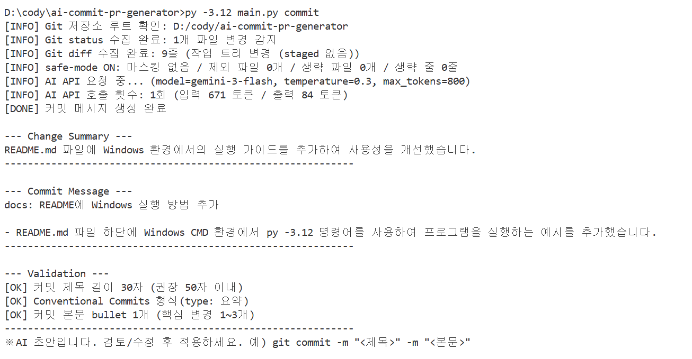
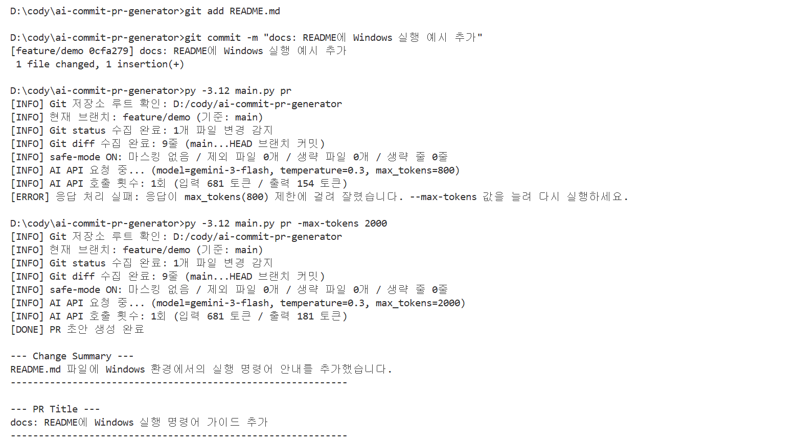
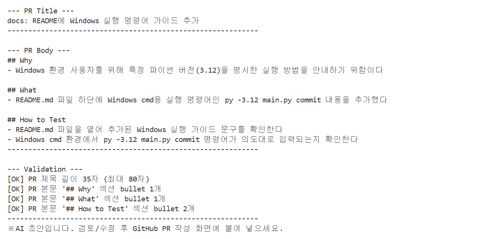
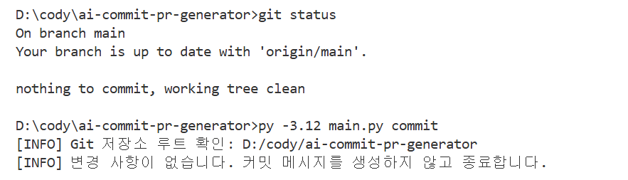
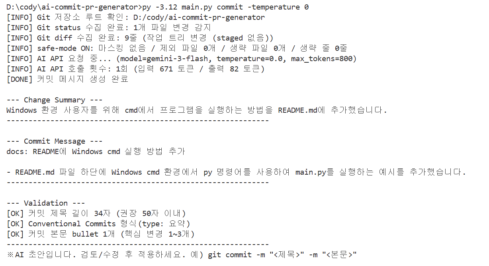
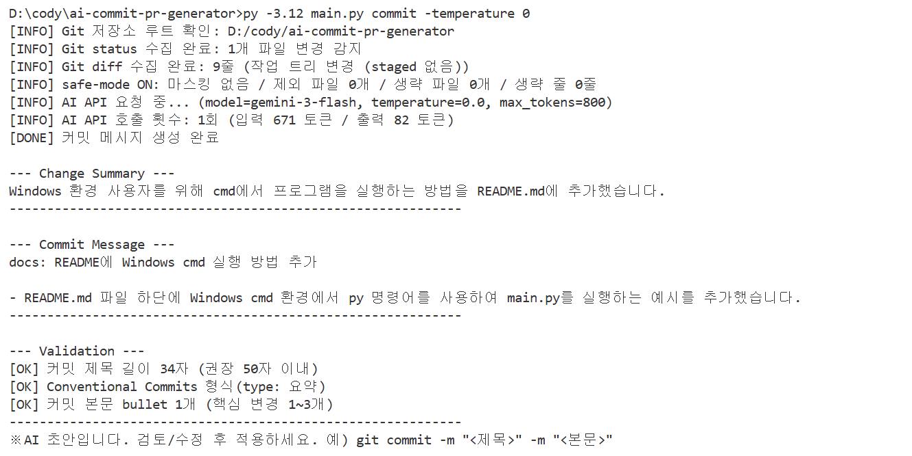
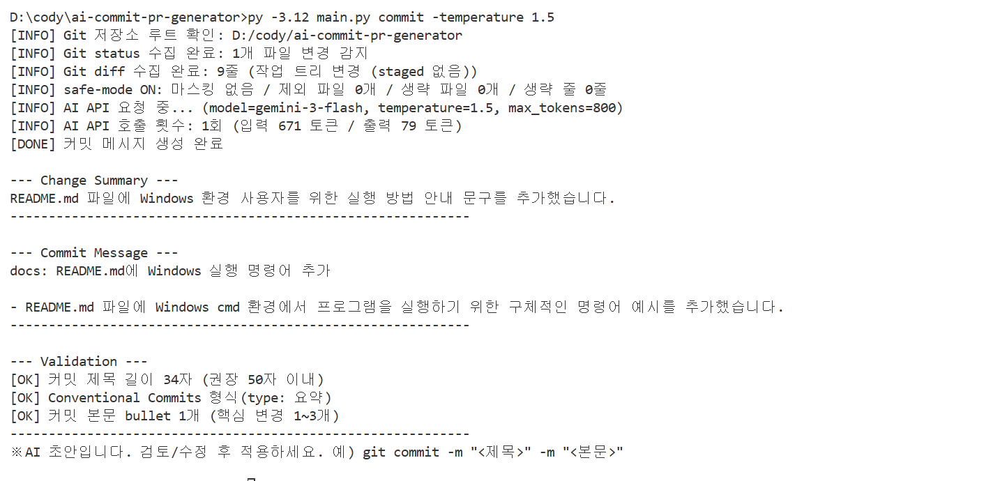
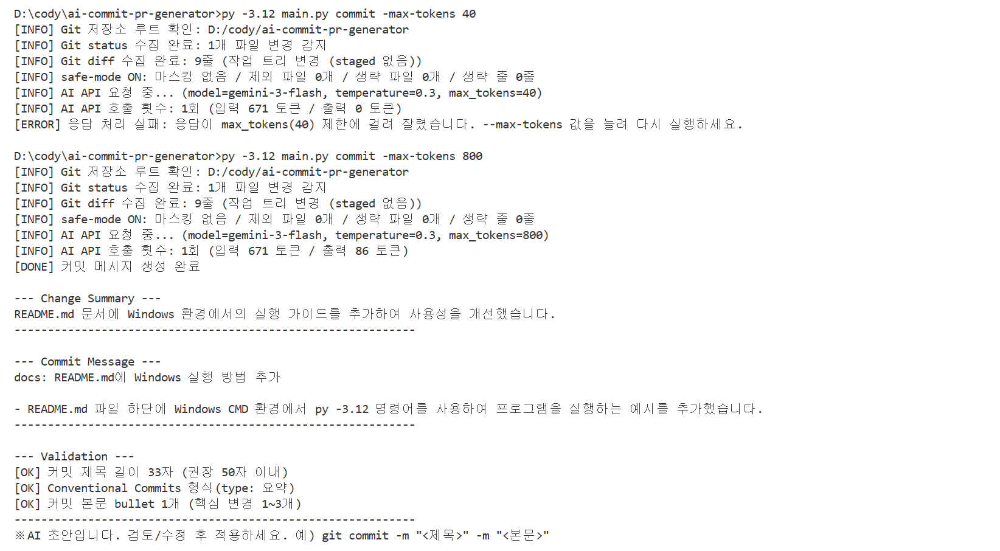

# 실행 증빙 — 평가 항목 1~7

Windows 명령 프롬프트(cmd)에서 이 저장소(`D:\cody\ai-commit-pr-generator`)를 대상으로 도구를 실제로 실행한 결과를 평가 항목별로 정리했습니다. 각 캡처 아래에 어떤 명령을 실행했고 결과가 무엇을 뜻하는지 적었습니다.

- 실행 환경: Windows 11, Python 3.12, Git
- AI API: Codyssey OpenAI 호환 엔드포인트(`AI_API_BASE_URL`), 모델 `gemini-3-flash`
- 시연용 변경: `feature/demo` 브랜치에서 README.md에 한 줄(Windows 실행 예시)을 추가

## 한눈에 보기

| 항목 | 평가 기준 | 증빙 | 결과 |
|---|---|---|---|
| 1 | 프로젝트 루트에서 커밋 명령 실행 시 커밋 메시지 출력 | [1](#1-커밋-메시지-생성) | 정상 |
| 2 | PR 명령 실행 시 PR 제목과 본문 초안 출력 | [2](#2-pr-제목본문-초안-생성) | 정상 |
| 3 | API Key 미설정 시 오류 메시지 출력 후 종료 | [3](#3-api-key-미설정-시-오류-후-종료) | 캡처 예정 |
| 4 | 변경 사항이 없을 때 "변경 사항이 없습니다" 출력 | [4](#4-변경-사항이-없을-때) | 정상 |
| 5 | PR 본문에 Why / What / How to Test 구조, 섹션마다 불릿 1개 이상 | [5](#5-pr-본문-why--what--how-to-test-구조) | 정상 |
| 6 | `-temperature` / `-max-tokens` 변경 시 출력 차이 재현 | [6](#6-temperature--max-tokens-변경에-따른-차이) | 정상 |
| 7 | 커밋/PR 출력이 길이·형식 규칙을 만족 | [7](#7-커밋pr-길이형식-규칙) | 정상 |

## 1. 커밋 메시지 생성



### 실행한 명령

```bash
py -3.12 main.py commit
```

README.md를 수정한 상태(아직 `git add` 하지 않음)에서 프로젝트 루트에서 실행했습니다.

### 결과 설명

- `Git 저장소 루트 확인` → 루트 디렉토리에서 실행했는지 먼저 검사합니다.
- `Git status 수집 완료: 1개 파일 변경 감지`, `Git diff 수집 완료: 9줄` → `git status`, `git diff` 결과를 프로그램 입력으로 수집했습니다. staged 변경이 없어 작업 트리 전체를 대상으로 했습니다.
- `AI API 호출 횟수: 1회 (입력 671 토큰 / 출력 84 토큰)` → 명령 1회에 API를 한 번만 호출했고 사용 토큰을 기록합니다.
- `--- Commit Message ---` 블록에 제목 `docs: README에 Windows 실행 방법 추가`와 변경 파일(README.md)을 언급한 본문 불릿 1개가 출력됐습니다. 사용자는 이 블록을 그대로 복사해 커밋에 쓸 수 있습니다.

## 2. PR 제목/본문 초안 생성




### 실행한 명령

```bash
git add README.md
git commit -m "docs: README에 Windows 실행 예시 추가"
py -3.12 main.py pr
py -3.12 main.py pr -max-tokens 2000
```

### 결과 설명

- `현재 브랜치: feature/demo (기준: main)`, `Git diff 수집 완료: 9줄 (main...HEAD 브랜치 커밋)` → PR은 기준 브랜치(main)와 비교한 브랜치 커밋 전체를 대상으로 합니다.
- 첫 실행(당시 기본값 `max_tokens=800`)은 `응답이 max_tokens(800) 제한에 걸려 잘렸습니다`로 끝났습니다. 화면에 보이는 출력은 154 토큰뿐이지만, `gemini-3-flash`는 답을 쓰기 전에 내부 추론 토큰을 쓰고 이것도 `max_tokens`에 포함되기 때문입니다. 잘린 JSON을 억지로 쓰지 않고 원인과 해결 방법을 안내한 뒤 종료합니다.
- `-max-tokens 2000`으로 다시 실행하자 `[DONE] PR 초안 생성 완료`와 함께 `--- PR Title ---`, `--- PR Body ---`가 출력됐습니다.
- 이 결과를 반영해 이후 기본값을 2000으로 올렸습니다.

## 3. API Key 미설정 시 오류 후 종료

> 캡처 추가 예정

### 실행할 명령

```bash
ren .env .env.bak
py -3.12 main.py pr
ren .env.bak .env
```

### 기대 결과

`[ERROR] AI_API_KEY 환경변수가 설정되지 않았습니다.`와 설정 예시를 출력하고, API를 호출하지 않은 채 종료합니다. API Key는 코드에 하드코딩하지 않고 환경변수(또는 `.env`)에서만 읽기 때문에, 키가 없으면 더 진행하지 않습니다.

## 4. 변경 사항이 없을 때



### 실행한 명령

```bash
git status
py -3.12 main.py commit
```

### 결과 설명

`git status`가 `nothing to commit, working tree clean`으로 변경이 없음을 보여 줍니다. 이 상태에서 실행하자 `변경 사항이 없습니다. 커밋 메시지를 생성하지 않고 종료합니다.`를 출력하고 끝났습니다. 변경이 없으면 API를 호출하지 않으므로 불필요한 비용도 발생하지 않습니다.

## 5. PR 본문 Why / What / How to Test 구조


### 결과 설명

항목 2의 PR 본문입니다.

- `## Why` → 변경 배경 불릿 1개 (Windows 사용자를 위해 Python 3.12 실행 방법 안내)
- `## What` → 핵심 변경 불릿 1개 (README.md 하단에 `py -3.12 main.py commit` 추가)
- `## How to Test` → 테스트 방법 불릿 2개 (README 확인, cmd에서 명령 확인)

세 섹션 헤더가 모두 있고 각 섹션에 불릿이 1개 이상 있습니다. 프롬프트에서 이 구조를 JSON(`why`, `what`, `how_to_test`)으로 요구하고, 코드에서 `## 헤더` + `- 불릿` 형식으로 조립합니다.

## 6. temperature / max-tokens 변경에 따른 차이

### temperature





```bash
py -3.12 main.py commit -temperature 0
py -3.12 main.py commit -temperature 0
py -3.12 main.py commit -temperature 1.5
```

| 실행 | 커밋 제목 | Change Summary | 출력 토큰 |
|---|---|---|---|
| temperature 0 (1회차) | docs: README에 Windows cmd 실행 방법 추가 | Windows 환경 사용자를 위해 cmd에서 프로그램을 실행하는 방법을 README.md에 추가했습니다. | 82 |
| temperature 0 (2회차) | docs: README에 Windows cmd 실행 방법 추가 | (1회차와 동일) | 82 |
| temperature 1.5 | docs: README.md에 Windows 실행 명령어 추가 | README.md 파일에 Windows 환경 사용자를 위한 실행 방법 안내 문구를 추가했습니다. | 79 |

temperature 0에서는 같은 입력에 대해 두 번 모두 글자 하나까지 같은 결과가 나왔습니다. 1.5로 올리면 같은 diff인데도 제목과 요약의 표현이 달라졌습니다. temperature는 결과의 무작위성을 조절하므로, 일관성이 중요한 커밋 메시지에는 낮은 값(기본 0.3)이 적합합니다.

### max-tokens



```bash
py -3.12 main.py commit -max-tokens 40
py -3.12 main.py commit -max-tokens 800
```

- `-max-tokens 40` → `출력 0 토큰`, `응답이 max_tokens(40) 제한에 걸려 잘렸습니다`. 응답을 쓰기도 전에 한도를 모두 써서 결과를 만들지 못했습니다.
- `-max-tokens 800` → 출력 86 토큰으로 정상 생성.

`max_tokens`는 응답 길이(그리고 비용)의 상한입니다. 너무 작으면 결과가 잘리기 때문에, 도구는 `finish_reason=length`를 감지해 값을 늘리라고 안내합니다. 항목 2의 PR 사례처럼 출력이 긴 작업이나 추론형 모델에서는 더 큰 값이 필요합니다.

## 7. 커밋/PR 길이·형식 규칙

출력의 `--- Validation ---` 블록이 규칙 검사 결과입니다. 길이 초과나 빈 섹션이 있으면 `[WARN]`과 함께 자르기/기본 불릿 채우기로 다듬습니다.

| 규칙 | 기준 | 실제 결과 | 증빙 |
|---|---|---|---|
| 커밋 제목 길이 | 50자 권장, 최대 72자 | 30자 `[OK]` | [항목 1 캡처](evidence/01-commit-message.png) |
| 커밋 제목 형식 | Conventional Commits (`type: 요약`) | `docs: ...` `[OK]` | [항목 1 캡처](evidence/01-commit-message.png) |
| 커밋 본문 | 변경 파일 언급 또는 핵심 변경 불릿 1~3개 | README.md 언급 불릿 1개 `[OK]` | [항목 1 캡처](evidence/01-commit-message.png) |
| PR 제목 길이 | 최대 80자 | 35자 `[OK]` | [항목 2 캡처](evidence/02-pr-draft-2.png) |
| PR 본문 구조 | Why / What / How to Test 헤더 + 섹션별 불릿 1개 이상 | 1개 / 1개 / 2개 `[OK]` | [항목 2 캡처](evidence/02-pr-draft-2.png) |

temperature나 max-tokens를 바꾼 실행(항목 6)에서도 커밋 제목은 33~34자로 모두 규칙을 만족했습니다.
